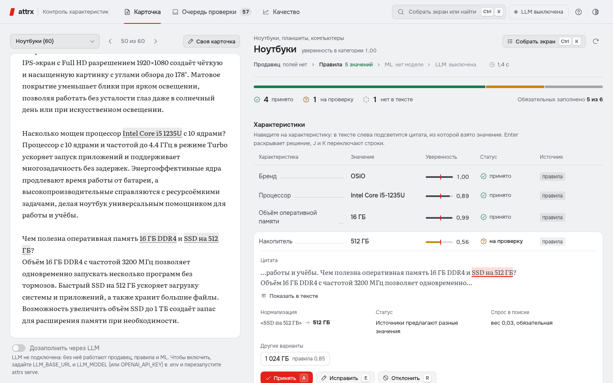
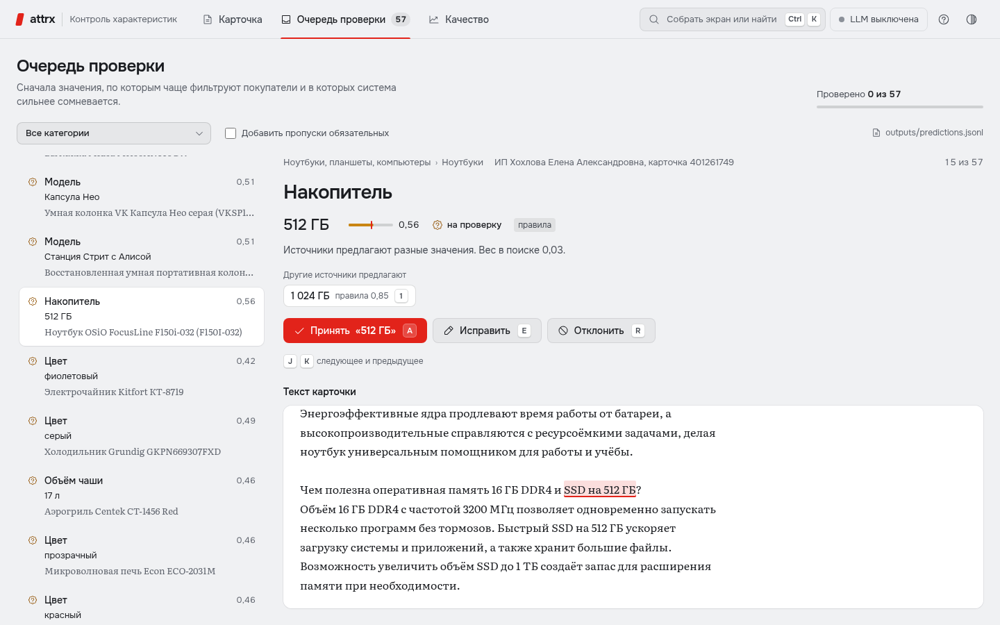
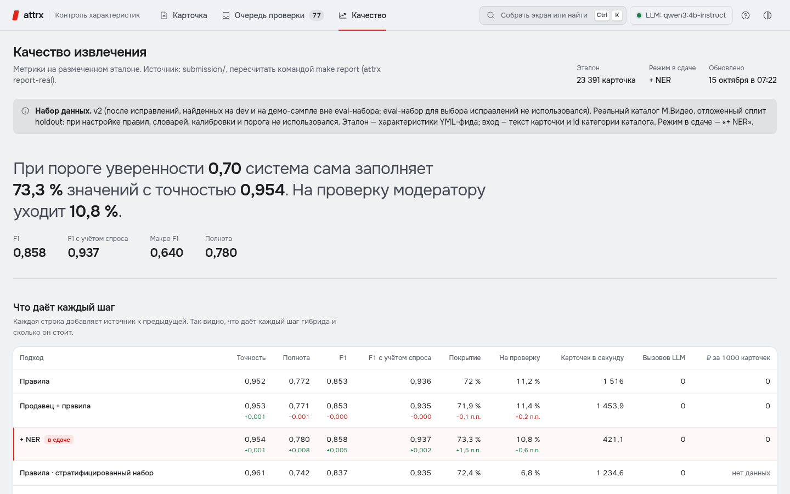

# attrx — автозаполнение характеристик товаров М.Видео

**Кейс № 3 «ИИ для автоматического заполнения характеристик товаров» (М.Видео), хакатон «Точка сборки».**
Пайплайн читает текстовую карточку товара (название, описание, атрибуты продавца), определяет категорию и обязательные
характеристики, извлекает значения, приводит их к каноническому виду и для **каждого** значения отдаёт уверенность,
источник и **дословную цитату из карточки**. Надёжное уходит в каталог, сомнительное — модератору; его правки пополняют словари.
Гибрид дешёвый там, где можно, и умный там, где нужно: **правила и словари → классификатор категории → NER → LLM только для остатка**.

Эталон — характеристики **реального каталога М.Видео** из архива организаторов (241 355 карточек), веса атрибутов —
30,99 млн реальных кликов из поиска. Настройка — только на dev; финальные метрики — на отложенном holdout, который для
настройки правил, словарей и калибровки не использовался.

## Результат (holdout: 23 391 карточка с эталоном)

Отложенный holdout — все карточки сплита с эталоном каталога, кроме 400 SKU демо-сэмпла (они использовались в демо и бенчмарке
LLM). Настройка правил, словарей, калибровки и порога — только на dev. Режим в сдаче — «правила + продавец + NER».

| Метрика | Значение | Что значит |
|---|---|---|
| Precision принятых значений | **0,954** (нижняя граница 95% ДИ 0,952) | доля автоматически принятых значений, совпадающих с эталоном М.Видео; принимается 94% найденного |
| Precision / Recall / F1 (micro) | 0,954 / 0,779 / **0,858** | полнота считается по всем эталонным значениям, включая те, которых нет в тексте карточки |
| Recall по извлекаемому эталону | **0,927** | полнота по значениям, которые вообще есть в тексте карточки |
| F1 с учётом поискового спроса | **0,937** | атрибуты, по которым чаще ищут и фильтруют (из query_clicks), весят больше |
| macro-F1 по атрибутам / по ячейкам «категория × атрибут» | 0,640 / 0,773 | среднее без весов: редкие атрибуты тянут вниз (см. «Слабые места») |
| Покрытие каталога | 80,7% → **88,1%** (+5 488 значений) | доля слотов «карточка × обязательный атрибут», заполненных до и после; новые значения — там, где каталог пуст |
| Поисковый спрос, по которому атрибут заполнен | 95,7% → **97,2%** | покрытие, взвешенное кликами из поиска |
| Справедливость F1: М.Видео / маркетплейс | 0,873 / 0,853 | партнёры маркетплейса — в пределах 2 п.п. (на dev до доработок было 0,654 / 0,447) |
| Справедливость F1: head / torso / tail категорий | 0,870 / 0,844 / 0,818 | самый слабый сегмент — хвост, разрыв с head 5 п.п. (на dev до доработок tail был 0,227) |
| Новые заголовки (нет дословно в train) | F1 0,841 (16 803 карточки) против 0,912 у повторов | 28% заголовков holdout встречаются в train; без них качество ниже, но держится |
| Калибровка (ECE) | 0,019 | порог автопринятия 0,70; у самого порога есть слабое место — см. «Ограничения» |
| На проверку модератору | 10,8% значений | всё, что ниже порога, конфликтует или найдено только LLM |
| Скорость | ~1 500 карточек/с на ядро (правила), 421 карточка/с с NER (GPU) | без сети; LLM — только для остатка |
| Стоимость 1000 карточек: гибрид vs «LLM на каждую» | 0,83 ₽ vs 5,6 ₽ (своя GPU) · 20,6 ₽ vs 84,6 ₽ (GigaChat Lite) | гибрид в 4–7 раз дешевле: LLM вызывается только для 31% карточек; без LLM (правила + NER) — меньше 0,01 ₽ |

Полный отчёт: [submission/REPORT.md](submission/REPORT.md) · протокол оценки и история прогонов (v1 → v2): [docs/EVALUATION.md](docs/EVALUATION.md) ·
данные и EDA: [docs/EDA.md](docs/EDA.md). Строки «правила» и «продавец + правила» пересчитываются из репозитория: `make verify`.

## Что даёт каждый шаг гибрида

Кейс просит начать с базлайна на правилах и показать, что даёт каждый следующий шаг. Каждая строка добавляет источник к предыдущей.

| Подход | Precision | Recall | F1 | Recall извлекаемый | F1 по спросу | Покрытие | Карточек/с | LLM-вызовов на 1000 |
|---|---|---|---|---|---|---|---|---|
| *Весь holdout, 23 391 карточка* |  |  |  |  |  |  |  |  |
| Правила и словари | 0,952 | 0,772 | 0,853 | 0,918 | 0,936 | 72,0% | 1 516 | 0 |
| + атрибуты продавца | 0,953 | 0,771 | 0,853 | 0,917 | 0,935 | 71,9% | 1 454 | 0 |
| **+ NER (distant supervision) — в сдаче** | **0,954** | **0,779** | **0,858** | **0,927** | **0,937** | **73,3%** | 421 (GPU) | 0 |
| *Стратифицированный набор, 2 416 карточек (все 13 категорий поровну)* |  |  |  |  |  |  |  |  |
| Правила → + NER | 0,961 → 0,961 | 0,742 → 0,749 | 0,837 → 0,842 | 0,921 → 0,930 | 0,935 → 0,937 | 72,4% → 73,4% | 1 235 → 382 | 0 |
| + NER без id категории (категорию определяет классификатор) | 0,961 | 0,749 | 0,842 | 0,930 | 0,937 | 73,4% | 257 | 0 |
| *Подвыборка для LLM, 662 карточки* |  |  |  |  |  |  |  |  |
| + NER | 0,962 | 0,759 | 0,849 | 0,929 | 0,933 | 75,0% | 401 | 0 |
| + LLM для остатка | 0,962 | 0,759 | 0,849 | 0,929 | 0,933 | 75,0% | 1 | 310 |

Как читать:
- **Правила и словари** закрывают ядро: 92% извлекаемых значений при precision 0,95, меньше 1 мс на карточку. Ключевые доработки
  на dev (словарь 4 822 брендов из каталога, модель после бренда, единицы и пары «8/256», калибровка) подняли F1 с 0,565 до 0,849.
- **Атрибуты продавца** почти ничего не добавляют на эталоне: блок «Характеристики» есть лишь у 6,6% карточек с эталоном
  (он у партнёров вне фида — там он и работает, см. [docs/EDA.md](docs/EDA.md)).
- **NER** добавляет +1 п.п. полноты по извлекаемому эталону и +1,3 п.п. покрытия при той же точности: ловит описательные фразы
  («потребляет 2000 Вт», «справляется с 6 кг белья») ([docs/NER.md](docs/NER.md)).
- **Без id категории** результат тот же: классификатор определил категорию всех 2 416 карточек верно ([docs/CATEGORY.md](docs/CATEGORY.md),
  точность 0,9998 на 29 504 карточках holdout против 0,921 у ключевых слов).
- **LLM** (локальная qwen3:4b-instruct) на подвыборке F1 не добавила: значения, которые нашла только она, верны в 38% случаев.
  Поэтому по нашему правилу такие значения **никогда не принимаются автоматически** — это подсказка модератору; ответы без
  подтверждения в тексте отбрасываются проверкой заземления. С моделью организаторов на ВМ замер повторяется `make report`.

**Слабые места** (F1 по атрибутам): время работы наушников 0,00, общий объём холодильника 0,03, материал 0,14, число камер 0,40,
высота 0,42 — в основном значения, которых нет в тексте карточки или которые каталог хранит иначе (с кейсом / без).
По категориям: планшеты 0,92, ноутбуки 0,92, смартфоны 0,90, ТВ 0,90, хвост (generic) 0,86 … наушники 0,74, аэрогрили 0,72,
холодильники 0,68. Подробно: [submission/REPORT.md](submission/REPORT.md).

## Соответствие требованиям кейса

| Требование кейса | Как закрыто | Где посмотреть |
|---|---|---|
| На входе только текст карточки (название, описание, атрибуты продавца), без изображений | `Card` = title + description + seller_attrs; из фида в карточку попадает только id категории (как у товара в каталоге), характеристики фида — только в эталон; без id категорию определяет классификатор | [src/attrx/schema.py](src/attrx/schema.py), [docs/EVALUATION.md §1](docs/EVALUATION.md) |
| Определить нужные атрибуты | категория → схема обязательных атрибутов (`config/taxonomy.yaml`); категория из id каталога, иначе классификатор по тексту | [src/attrx/taxonomy.py](src/attrx/taxonomy.py), [src/attrx/category.py](src/attrx/category.py) |
| Канонический вид значений | единицы (ТБ→ГБ, см↔дюйм, мА·ч), числа, справочники синонимов (RU/EN цвета → 17 базовых, 4 822 бренда из каталога с транслитерацией), модель/CPU | [src/attrx/normalize.py](src/attrx/normalize.py), [config/dictionaries/](config/dictionaries) |
| Уверенность у каждого значения | агрегация источников + **калибровка** на dev (вероятность «значение верно») | [src/attrx/confidence.py](src/attrx/confidence.py), [config/calibration.json](config/calibration.json), [submission/calibration.json](submission/calibration.json) |
| В каталог — только надёжное, сомнительное — на ручную проверку | порог 0,70 выбран на dev (кросс-фиттинг) под precision принятых ≥ 0,95; на holdout — 0,954; статусы `accepted / review / missing`; очередь модератора | [submission/threshold.json](submission/threshold.json), UI «Очередь проверки» |
| **Не выдумывать характеристики** | схема вывода (strict JSON), справочники допустимых значений в промпте, **обязательная цитата**, проверка заземления (цитата выравнивается по тексту, значение должно из неё следовать), порог; **значение только от LLM никогда не принимается автоматически** | [src/attrx/verify.py](src/attrx/verify.py), [src/attrx/extractors/llm.py](src/attrx/extractors/llm.py), [tests/test_grounding.py](tests/test_grounding.py) |
| Учитывать стоимость: гибрид | дешёвые правила закрывают ядро; NER и LLM — только для слабых/пустых/конфликтных атрибутов; кэш LLM, лимиты вызовов, on-prem модель | [src/attrx/pipeline.py](src/attrx/pipeline.py), [docs/LLM.md](docs/LLM.md), [submission/cost.json](submission/cost.json) |
| Одинаково хорошо для всех категорий и продавцов | метрики по сегментам: продавец М.Видео / партнёр, head / torso / tail категорий, длина описания | [submission/segments.json](submission/segments.json), [docs/EVALUATION.md §5](docs/EVALUATION.md) |
| Базлайн на правилах → ML / LLM, показать вклад каждого шага | таблица выше + абляция правил | [submission/compare.json](submission/compare.json), [docs/EVALUATION.md §8](docs/EVALUATION.md) |
| Петля обратной связи | правки модератора → `outputs/feedback.jsonl` → `attrx learn` → синонимы в `learned.yaml` (только значение из справочника или ≥ 2 одинаковых правки на разных карточках, остальное — кандидаты на подтверждение); `attrx monitor` — дрейф → дообучение; эталон каталога → обучение NER | [src/attrx/feedback.py](src/attrx/feedback.py), [docs/MONITORING.md](docs/MONITORING.md), UI «Очередь проверки» |
| Метрики: P/R/F1 по атрибутам, покрытие, качество с учётом трафика, эталон по категориям | всё считается одной командой; веса трафика — из реальных поисковых кликов | [src/attrx/eval/metrics.py](src/attrx/eval/metrics.py), [submission/metrics.json](submission/metrics.json), [config/traffic_weights.yaml](config/traffic_weights.yaml) |
| Риски и меры их снижения | галлюцинации, стоимость, слабая оценка хвоста, дрейф, справедливость — с кодом и статусом | [docs/RISKS.md](docs/RISKS.md) |
| Внедрение | Docker, батч и API, on-prem LLM без VPN, теневой режим → автопринятие по порогу | [docs/DEPLOYMENT.md](docs/DEPLOYMENT.md) |

## Шесть артефактов сдачи

| # | Артефакт | Где |
|---|---|---|
| 1 | Код, воспроизводящий решение | пакет [src/attrx](src/attrx), CLI `attrx`, [Makefile](Makefile) |
| 2 | README с установкой и запуском | этот файл |
| 3 | EDA: поля, пропуски, распределения | [notebooks/01_eda.ipynb](notebooks/01_eda.ipynb) (исполнен, с выводами) и сводка [docs/EDA.md](docs/EDA.md) |
| 4 | Пайплайн от текста карточки до атрибутов | [src/attrx/pipeline.py](src/attrx/pipeline.py); `attrx extract`, `POST /api/extract` |
| 5 | Файл с предсказанными атрибутами по каждой карточке | [submission/predictions.csv](submission/predictions.csv) и [predictions.jsonl](submission/predictions.jsonl) (holdout) |
| 6 | Финальная презентация: подход, метрики, выводы | [docs/slides.pdf](docs/slides.pdf) (исходник [docs/slides.html](docs/slides.html)); концепция к чекпоинту — [docs/checkpoint/concept.pdf](docs/checkpoint/concept.pdf) |

## Быстрый старт (5 минут, датасет не нужен)

Нужны Python 3.10+ и [uv](https://docs.astral.sh/uv/) (или обычный `pip`).

~~~bash
uv venv -p 3.11 .venv && uv pip install -p .venv/bin/python -e ".[dev]"   # или: python -m venv .venv && .venv/bin/pip install -e ".[dev]"
#   строго по uv.lock (как в CI): uv sync --frozen --extra dev
.venv/bin/attrx demo     # прогон на 400 реальных карточках из holdout (data/sample) + метрики
.venv/bin/attrx serve    # http://localhost:8000 — интерфейс модератора, API, Swagger на /docs (слушает только 127.0.0.1)
.venv/bin/attrx verify   # пересчитать строки «правила» и «продавец + правила» submission/compare.json на закоммиченном holdout (офлайн)
.venv/bin/pytest -q && .venv/bin/ruff check .
~~~

Docker: `docker compose up --build` → http://localhost:8000. С локальной LLM рядом: `docker compose --profile llm up --build`
(Ollama поднимается в соседнем контейнере и сама скачивает модель).

Демо на ВМ хакатона (порт 8000 снаружи): `.venv/bin/attrx serve --host 0.0.0.0 --port 8000` (= `make serve-public`);
Docker слушает 0.0.0.0 сам. По умолчанию `attrx serve` слушает только 127.0.0.1. Запись решений модератора можно закрыть
токеном: `ATTRX_TOKEN=<секрет>` → `POST /api/feedback` и `/api/feedback/undo` требуют заголовок `X-Attrx-Token`
(встроенный интерфейс токен не шлёт — на демо не задавать).

Без LLM и без интернета работает всё: правила, словари, классификатор категории. LLM подключается автоматически,
если задан ключ (`LLM_*` или `OPENAI_API_KEY` / `OPENAI_BASE_URL` — так настроена ВМ хакатона), см. [docs/LLM.md](docs/LLM.md).

Windows (PowerShell)

~~~powershell
docker compose up -d --build         # http://localhost:8000
# или без Docker:
uv venv -p 3.11 .venv
uv pip install -p .venv\Scripts\python.exe -e ".[dev]"
.venv\Scripts\attrx demo
.venv\Scripts\attrx serve
~~~
Если UI отвечает `{"detail":"Not Found"}`, запустите из корня репозитория или задайте `ATTRX_ROOT=<путь к репо>`.

## Полный прогон на данных организаторов

~~~bash
make data                      # скачать и распаковать архив кейса (1,1 ГБ) в data/raw
.venv/bin/attrx prepare                  # YML-фид, описания, клики -> data/processed (~8 мин, пик 11,8 ГБ RAM)
.venv/bin/attrx build-gold               # эталон из каталога -> gold.parquet, gold_{dev,holdout}.jsonl
.venv/bin/attrx traffic                  # веса атрибутов по поисковому спросу -> config/traffic_weights.yaml
.venv/bin/attrx build-dicts              # справочник брендов из каталога (только train)
.venv/bin/attrx train-category           # классификатор категории -> models/category (~6 мин, CPU)
uv pip install -p .venv/bin/python -e ".[ml]"                     # torch + transformers для NER
#   GPU GTX 10xx: torch из индекса cu126 (новые CUDA-сборки эти карты не поддерживают):
#   uv pip install -p .venv/bin/python torch --index-url https://download.pytorch.org/whl/cu126
NER_DEVICE=cuda .venv/bin/attrx train-ner --distant   # NER на distant supervision -> models/ner (~14 мин на GTX 1060)
NER_DEVICE=cuda .venv/bin/attrx calibrate --sources seller,rules,ml   # калибровка и порог на dev -> config/calibration.json
.venv/bin/attrx eval-real --split dev    # метрики на dev (настраиваемся только здесь)
make report                    # = attrx report-real: отчёт на holdout -> submission/ (без --force не перезапишет сдачу другой LLM)
make verify                    # сверка: строки «правила» и «продавец + правила» пересчитываются на data/sample/holdout_eval_*.jsonl
make monitor                   # дрейф: предсказания против holdout (PSI категорий, generic, review/missing, уверенность, доля LLM)
.venv/bin/attrx eda-real                 # графики EDA; ноутбук: uv pip install -p .venv/bin/python -e ".[eda]" && make eda-nb
~~~

## Как это работает

~~~
 Карточка: title + description + атрибуты продавца
     │
     ▼
 Категория ── id каталога → схема атрибутов │ нет id → классификатор (TF-IDF + линейная модель, 0,9998) │ иначе ключевые слова
     │
     ▼
 Продавец (ключи «Характеристики» → атрибуты) ─► Правила и словари (числа с единицами, бренды, цвета, CPU, пары «8/256») 
     │
     ▼
 Агрегация источников (noisy-OR, штраф за конфликт) ── закрыт уверенно? ── да ──────────────────────────┐
     │ нет: пусто / слабо / конфликт                                                                       │
     ▼                                                                                                     │
 NER (ruBERT-tiny2, BIO, обучен на эталоне каталога) ─► LLM в контуре (strict JSON, справочники, цитата)   │
     │                                                                                                     │
     ▼                                                                                                     │
 Заземление: цитата выравнивается по тексту, значение должно из неё следовать — иначе отброшено (в лог)    │
     │                                                                                                     │
     ▼                                                                                                     ▼
 Калиброванная уверенность → статус: accepted (≥ 0,70) · review (ниже порога, конфликт, только LLM) · missing
     │
     ├─► submission/predictions.* · POST /api/extract(/batch) · интерфейс модератора
     └─► правки модератора → feedback.jsonl → attrx learn → словари
~~~

Подробно: [docs/ARCHITECTURE.md](docs/ARCHITECTURE.md). Почему не «LLM на каждую карточку»: в 4–7 раз дороже гибрида
(и на порядки дороже режима «правила + NER»), секунды вместо миллисекунд на карточку, ответы нужно заземлять — а на нашем
holdout одиночные значения LLM верны лишь в 38% случаев. Правила закрывают ядро детерминированно и почти бесплатно.

## Данные

Архив организаторов: YML-фид каталога М.Видео (546 069 офферов, 6 963 категории, характеристики `param`),
1 177 200 описаний карточек, 30 991 350 кликов из поиска. Эталон = характеристики фида (их заполняет и проверяет
контент-команда, по ним работают фильтры сайта); вход модели — только текст карточки.
Главное из EDA ([docs/EDA.md](docs/EDA.md)):
- 56,5% кликов поиска — по запросам, где покупатель называет атрибут (24,9% — характеристику кроме бренда и модели);
- у 74,8% карточек нет ни оффера, ни категории — только текст (cold start → классификатор категории);
- значительной части эталона нет в тексте карточки (диагональ смартфона — у 34–51%, батарея — у 50%) → считаем
  отдельно полноту по «извлекаемому» эталону, а LLM не позволяем «додумывать».

## Интерфейс модератора

`attrx serve` → http://localhost:8000. Три экрана, без сборки фронтенда, все ассеты свои (работает в закрытом контуре):
- **Карточка** — текст карточки и характеристики рядом; наведение на характеристику подсвечивает цитату; трасса
  «Продавец › Правила › ML › LLM», уверенность с отметкой порога, конфликты и альтернативы.
- **Очередь проверки** — сначала то, что чаще ищут и в чём система сильнее сомневается; клавиши J/K, A — принять,
  E — исправить, R — отклонить; правки сразу пишутся в обратную связь.
- **Качество** — лестница подходов, порог и покрытие, калибровка, стоимость, категории × атрибуты.
- **⌘K / Ctrl+K — generative UI**: экран собирается под запрос («покажи только конфликты») из фиксированного набора
  безопасных компонентов; значения берутся из результата, а не из ответа модели ([docs/GENUI.md](docs/GENUI.md)).

| Очередь проверки | Качество |
|---|---|
|  |  |

## API

| Метод | Что делает |
|---|---|
| `POST /api/extract` | `{card, use_llm?, intent?}` → результат + собранный интерфейс; `card.id` необязателен; `use_llm: true` без настроенной LLM работает с предупреждением |
| `POST /api/extract/batch` | до 1000 карточек за запрос (интеграция с PIM) |
| `GET /api/review/queue` | очередь проверки, отсортированная по спросу × неуверенности |
| `POST /api/feedback`, `/api/feedback/undo` | правка модератора / отмена (при заданном `ATTRX_TOKEN` — заголовок `X-Attrx-Token`) |
| `POST /api/ui` | пересобрать экран под новый запрос (generative UI) |
| `GET /api/report`, `/api/metrics` | артефакты качества из `submission/` (`/api/metrics?source=outputs` — последний `attrx demo`) |
| `GET /api/examples`, `/api/categories`, `/api/taxonomy`, `/api/dictionary/{name}` | примеры карточек, схема категорий, справочники |
| `GET /api/health` | статус: модель категорий, NER, LLM (провайдер, модель, доступность), порог |

Swagger: http://localhost:8000/docs.

## LLM: где и зачем

LLM вызывается только для атрибутов, которые продавец, правила и NER не закрыли уверенно, и всегда в рамках
анти-галлюцинационного контракта. Провайдер — любой OpenAI-совместимый endpoint без VPN: ключ организаторов на ВМ
(подхватывается сам), GigaChat, YandexGPT, vLLM/Ollama on-prem. Локально проверено на `qwen3:4b-instruct` (Ollama, GTX 1060):
JSON валиден в 100% ответов, precision 95% на бенчмарке из 30 карточек смартфонов и ноутбуков, когда модель извлекает **все**
атрибуты карточки. В гибриде ей достаются только трудные остатки, которые не закрыли правила и NER: там её одиночные значения
верны лишь в 38% случаев, поэтому они всегда уходят на проверку. Рекомендуемый режим по умолчанию — правила + NER
(≈0,002 ₽ на 1000 карточек), LLM — подсказка модератору и cold start. Подробно и с бенчмарком: [docs/LLM.md](docs/LLM.md).

## Ограничения (честно)

- **Полная схема характеристик — у 12 категорий** (смартфоны, ноутбуки, планшеты, ТВ, стиральные машины, холодильники,
  наушники, пылесосы, смарт-часы, чайники, аэрогрили, сплит-системы) — это около половины кликов поиска. Остальные листья
  каталога (их 3 583) получают универсальную схему «бренд, модель, цвет»; новая категория подключается правкой
  `config/taxonomy.yaml` без кода, данные для этого уже посчитаны (`attrx prepare` → `taxonomy_candidates.json`).
- **Эталон — характеристики фида**, а не ручная разметка: в нём есть шум (например, iPhone 15 с диагональю 6,6″),
  поэтому потолок точности ≈ 0,97–0,99; выборочного ручного аудита эталона нет.
- **Значительной части эталона нет в тексте** (81% наших промахов) — ни один метод «по тексту» их не найдёт; поэтому
  отдельно показываем полноту по извлекаемому эталону.
- **NER-модель (115 МБ) не хранится в git** — обучается командой `attrx train-ner --distant` (~14 мин на GTX 1060);
  без неё работают правила и словари. Строки «правила» и «продавец + правила» проверяемы из репозитория (`make verify`).
- **LLM на локальной 4B-модели прироста не дала**; с моделью организаторов на ВМ замер повторяется командой из раздела LLM.
- **Калибровка переоценивает уверенность у самого порога**: принятые значения с уверенностью 0,70–0,80 верны лишь в 57% случаев
  (2 008 значений, 4% принятого, но 38% ошибок среди принятого; 91% из них — цвет и модель в хвосте). На dev картина та же.
  Кандидат исправления найден только на dev (калибровка на всём dev → порог 0,82: precision принятых 0,982 при доле
  автопринятия 85,5% вместо 94%), но не применён: выбор после просмотра holdout нарушил бы протокол. Весь поток принятых
  значений при этом держит precision 0,954.

## Риски и внедрение

| Риск из кейса | Мера в решении |
|---|---|
| Галлюцинации LLM | цитата + заземление + справочники + порог; только-LLM → всегда на проверку |
| Стоимость на масштабе | LLM только для остатка (31% карточек), кэш, лимиты, on-prem модель: 0,83 ₽ / 1000 карточек; без LLM — меньше 0,01 ₽ |
| Слабая оценка хвоста | эталон по каждой категории, разрезы head/torso/tail, «извлекаемый» recall |
| Новые категории (дрейф) | классификатор категории + generic-схема + LLM-предложения со статусом review; `attrx monitor`: PSI категорий, доля generic и неуверенной категории → алерт → дообучение ([docs/MONITORING.md](docs/MONITORING.md)) |
| Несправедливость к продавцам | одинаковые метрики для М.Видео и партнёров маркетплейса |

Подробно: [docs/RISKS.md](docs/RISKS.md), раскатка (тень → автопринятие по порогу, мониторинг) — [docs/DEPLOYMENT.md](docs/DEPLOYMENT.md),
продукт — [docs/PRD.md](docs/PRD.md).

## Структура репозитория

~~~
config/            taxonomy.yaml (категории → обязательные атрибуты + маппинг на эталон), dictionaries/*.yaml,
                   calibration.json, traffic_weights.yaml, llm_prices.yaml, brand_aliases.yaml, enum_map.json
src/attrx/
  data/            подготовка данных: YML-фид, очистка HTML и блока «Характеристики», клики, EDA, трафик
  extractors/      seller.py, rules.py, ner.py (+ ner_distant.py), llm.py
  category.py      классификатор категории по тексту
  normalize.py     единицы, числа, справочники, модели и процессоры
  verify.py        заземление и выравнивание цитат (анти-галлюцинации)
  confidence.py    агрегация источников и калибровка
  pipeline.py      оркестратор
  monitor.py       мониторинг дрейфа (attrx monitor)
  reproduce.py     сверка цифр сдачи (attrx verify)
  llm/             OpenAI-совместимый клиент, кэш SQLite, статус, бенчмарк, стоимость
  eval/            эталон, метрики, калибровка, отчёт
  genui/           схема компонентов и композитор generative UI
  api/app.py       FastAPI
  cli.py           команды attrx
web/               интерфейс модератора (ES-модули + CSS, без сборки)
models/category/   классификатор категории (в git); models/ner — обучается командой, в git не входит
data/sample/       400 реальных карточек holdout + эталон (для демо и тестов) и 20 синтетических (юнит-тесты)
notebooks/         EDA
submission/        предсказания и отчёт для сдачи
docs/              архитектура, оценка, EDA, LLM, NER, категории, риски, внедрение, PRD, презентации
~~~

## Тесты и CI

`pytest` — 360 тестов (нормализация, правила на реальных примерах, заземление и выравнивание цитат, политика доверия к LLM,
эталон и метрики, классификатор категории, NER-разметка, API, клиент LLM с моками, сверка цифр сдачи, мониторинг дрейфа,
безопасные умолчания API, битые ссылки в документации). CI (GitHub Actions): установка по `uv.lock`, `ruff`, `pytest`, `attrx demo`, `attrx verify`, `attrx monitor`.

## Сторонний код, модели и ассеты

- Шрифты Onest и Literata (SIL OFL 1.1), иконки Phosphor (MIT) — подробности и лицензии: [web/assets/CREDITS.md](web/assets/CREDITS.md).
- Модели: [cointegrated/rubert-tiny2](https://huggingface.co/cointegrated/rubert-tiny2) (MIT) — основа NER;
  Qwen3-4B-Instruct-2507 через Ollama (Apache 2.0) — локальная LLM.
- Библиотеки: FastAPI, pydantic, pandas, pyarrow, DuckDB, rapidfuzz, scikit-learn, PyTorch, transformers, openai (Python SDK).
- Данные: архив кейса организаторов (в репозиторий не входит, скачивается `make data`).
- Навыки для агента разработки (Claude Code) в `.claude/skills/`, источники и хэши — [skills-lock.json](skills-lock.json):
  frontend-design (anthropics/skills, Apache-2.0), agent-browser (vercel-labs/agent-browser, Apache-2.0),
  find-skills (vercel-labs/skills, MIT), grill-me и grilling (mattpocock/skills, MIT), interface-design (Dammyjay93/interface-design, MIT).
  В код продукта они не входят; база знаний команды для работы с агентом — [CLAUDE.md](CLAUDE.md) и `.claude/context/`.

## Команда

| Кто | Зона |
|---|---|
| jasperBLCK | правила, нормализация, LLM-промпты, метрики, EDA |
| Makhkets | UI и generative UI, API-интеграция, демо, презентация |

Как работаем: [CONTRIBUTING.md](CONTRIBUTING.md).
