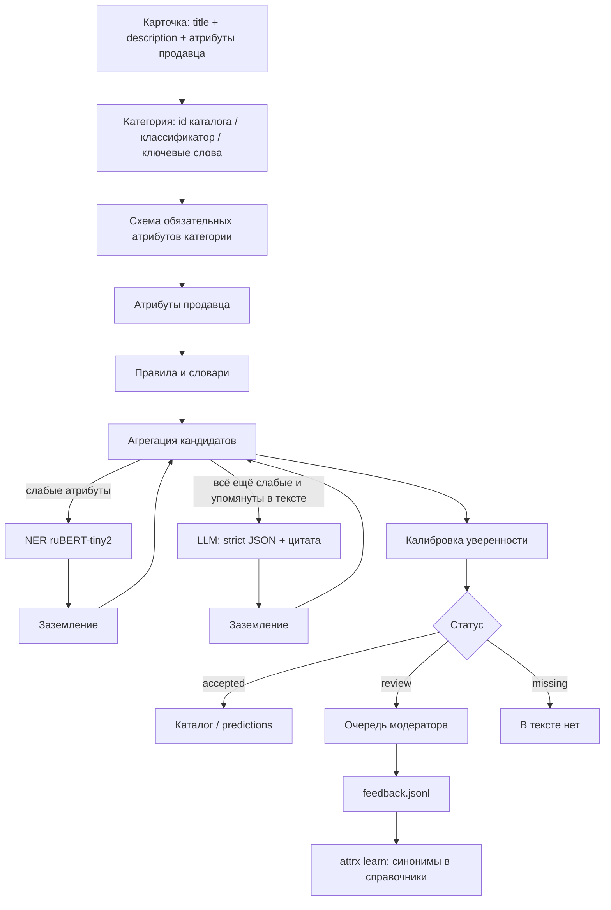

# Архитектура attrx

attrx заполняет характеристики товара по тексту карточки. На входе название, описание и атрибуты продавца. Пайплайн
определяет категорию и её обязательные атрибуты, извлекает значения лестницей от дешёвых методов к дорогим, приводит
значения к канону справочников и проверяет, что каждое значение подтверждено цитатой из карточки. Каждому значению
он выставляет калиброванную уверенность и статус: «в каталог», «на проверку» или «в тексте нет». Сомнительное попадает
в очередь модератора, а его правки пополняют словари.

Цифры в документе взяты из отчётов репозитория, у каждой указана выборка. **dev** — выборка, на которой настраивались
правила и пороги. **holdout** — отложенная выборка, на ней ничего не подбиралось. **Бенчмарк** — 30 реальных карточек
для сравнения LLM. Сплиты детерминированы: `md5(sku_id)` даёт train 80% / dev 10% / holdout 10%
([EVALUATION.md](EVALUATION.md)).

## 1. Схема

```
 Карточка товара: title + description + атрибуты продавца     (только текст; поля каталога - только эталон)
        |
        v
 [1] Категория -> схема обязательных атрибутов (config/taxonomy.yaml)
       category_id каталога (1.0) -> иначе классификатор по тексту (порог 0.9) -> иначе ключевые слова
        |
        v
 [2] Атрибуты продавца ("Характеристики:")  +  [3] Правила и словари (бренды каталога, числа с единицами, цвета, CPU)
        |
        v
 [4] Агрегация кандидатов: noisy-OR по источникам; спор источников -> штраф и альтернативы
        |   атрибут пуст / уверенность ниже 0.6 / конфликт
        v
 [5] NER (ruBERT-tiny2, обучен на эталоне каталога) ---> заземление ---> агрегация
        |   все еще слабый И упомянут в тексте
        v
 [6] LLM в контуре: strict JSON + справочник + дословная цитата ---> заземление ---> агрегация
        |
        v
 [7] Калибровка уверенности (изотоническая регрессия на dev) ---> статус
        accepted : уверенность >= 0.69, источники не спорят, значение не "только от LLM"
        review   : ниже порога / конфликт / только LLM / категория определена неуверенно
        missing  : значения в тексте нет
        |
        v
 ExtractionResult: канон + единица + уверенность + статус + источники + цитата со смещениями в тексте
        |                          |                              |
 predictions.jsonl / .csv    REST API (FastAPI)        UI модератора и generative UI
                                                                  | решение модератора
                                                                  v
                                  feedback.jsonl ---> attrx learn ---> справочники ---> следующий прогон
```



Код оркестратора — [`src/attrx/pipeline.py`](../src/attrx/pipeline.py) (`Extractor.extract`).

## 2. Требования кейса → механизм

| Требование кейса | Механизм | Код |
|---|---|---|
| На входе только текст карточки | `Card` = title + description + seller_attrs; характеристики фида используются только как эталон | [`schema.py`](../src/attrx/schema.py) |
| Определить, какие атрибуты нужны | категория → схема атрибутов из `config/taxonomy.yaml` | [`taxonomy.py`](../src/attrx/taxonomy.py), [`category.py`](../src/attrx/category.py) |
| Канонический вид и уверенность | нормализация к единицам и справочникам; калиброванная уверенность у каждого значения | [`normalize.py`](../src/attrx/normalize.py), [`confidence.py`](../src/attrx/confidence.py) |
| В каталог только надёжное | статусы `accepted` / `review` / `missing`, порог подобран на dev под точность принятых | [`pipeline.py`](../src/attrx/pipeline.py) |
| Не выдумывать характеристики | схема вывода, справочники, цитата, заземление, порог, инвариант «только LLM → проверка» (раздел 5) | [`verify.py`](../src/attrx/verify.py), [`extractors/llm.py`](../src/attrx/extractors/llm.py) |
| Учитывать стоимость | лестница: LLM только для слабых атрибутов, которые упомянуты в тексте; кэш и лимиты | [`pipeline.py`](../src/attrx/pipeline.py), [`llm/`](../src/attrx/llm) |
| Справедливость | словари из всего каталога, а не из ручного списка; метрики по продавцам, размеру категории и длине описания | [`eval/metrics.py`](../src/attrx/eval/metrics.py) |
| Показать вклад каждого шага | любой набор источников меряется на одной выборке: `attrx eval-real --sources …`, `attrx report` | [`eval/`](../src/attrx/eval) |
| Петля обратной связи | правки модератора → словари; эталон каталога → обучение NER | [`feedback.py`](../src/attrx/feedback.py) |

## 3. Почему лестница, а не «всё в LLM»

Кейс сравнивает подходы по пяти осям. Мы используем каждый подход там, где он сильнее, и платим за дорогой метод только
когда дешёвые не справились.

| Слой | Что закрывает | Стоимость | Данные для обучения | Новые категории | Замер |
|---|---|---|---|---|---|
| Правила и словари | ядро: бренд, модель, память, диагональ, числа с единицами, цвета, справочники | CPU, 380–540 карточек/с на ядро | ручная разметка не нужна: справочники строятся из каталога (train) | правка таксономии плюс автоматическая пересборка словарей | dev: F1 0,844, precision 0,971 |
| Классификатор категории | категория у карточек без неё (75%) | CPU, 1–1,3 мс на карточку | категории каталога (train) | отображение листьев каталога на категории без переобучения | holdout: точность 0,9998 против 0,921 у ключевых слов |
| NER | формулировки, которые правила не знают | малый энкодер, CPU | distant supervision из каталога | требует эталона категории | [NER.md](NER.md) |
| LLM | cold start, редкие атрибуты | секунды на вызов, оплата за токены | не нужны (zero-shot по схеме) | сразу, но со статусом `review` | бенчмарк: precision 95%, 6,9 с на карточку |

- **Деньги.** «LLM на каждую карточку» стоит 84,55 ₽ (GigaChat Lite) и 260,15 ₽ (YandexGPT Lite) на 1000 карточек.
  В гибриде вызов короче (только слабые атрибуты), и стоимость равна 69,36 ₽ и 213,40 ₽ на 1000 вызовов, умноженным
  на долю карточек, где LLM действительно позвали ([LLM.md §6](LLM.md)).
- **Значение может отсутствовать в тексте.** На dev 73% непойманных эталонных значений в тексте карточки просто нет
  ([EVALUATION.md §8.5](EVALUATION.md)). Если спросить о таком атрибуте LLM, заземлённого ответа не будет, а соблазн
  «вспомнить» характеристику модели будет. Поэтому LLM не спрашивают о том, что в тексте не упомянуто.
- **Контроль и воспроизводимость.** Правила детерминированы, LLM работает с temperature 0 и кэшем ответов. Решение
  о значении принимают проверка заземления и порог, а не модель.

## 4. Слои

### 4.1 Категория и схема атрибутов

- `config/taxonomy.yaml`: 12 категорий и `generic` (бренд, модель, цвет — для длинного хвоста). Смартфоны — листья
  каталога 761 и 914 (iPhone), ноутбуки — 987, с обязательными атрибутами ровно по кейсу. Атрибуты остальных
  категорий выбраны по данным: заполненность в каталоге × спрос в поиске × извлекаемость из текста.
- Порядок решения ([`Taxonomy.classify`](../src/attrx/taxonomy.py)). Если `category_id` есть в каталоге, уверенность
  1,0. Иначе работает классификатор по тексту: TF-IDF и двухуровневая линейная модель «раздел каталога → лист»,
  инференс на numpy, артефакт 7,8 МБ без pickle. Если модели нет, категория определяется по ключевым словам.
- Ниже порога 0,9 категория остаётся лучшей гипотезой модели, но все значения карточки уходят на проверку
  с предупреждением.
- **holdout, 29 504 карточки** ([CATEGORY.md](CATEGORY.md)): точность категории таксономии 0,9998 против 0,921
  у ключевых слов, macro-F1 0,998 против 0,790. Лист каталога (1 087 классов): top-1 0,984, top-3 0,990. ECE 0,0001.
  На проверку уходит 0,02% карточек holdout и 0,12% карточек без категории.

### 4.2 Атрибуты продавца

Блок «Характеристики:» в описании разбирается при подготовке данных в пары «ключ: значение»
([`data/text.py`](../src/attrx/data/text.py)). Ключ сопоставляется с атрибутом по `aliases` из таксономии, значение
нормализуется ([`extractors/seller.py`](../src/attrx/extractors/seller.py)). Продавцы ошибаются, поэтому базовая
оценка 0,8, а не 1,0. Если продавец пишет одно, а текст карточки другое, значение уходит модератору. У карточек с
эталоном блок продавца редок (6,6%), у карточек вне фида он встречается в 37,5% случаев ([EVALUATION.md §6](EVALUATION.md)).

### 4.3 Правила и словари

[`extractors/rules.py`](../src/attrx/extractors/rules.py) работает с одной строкой текста карточки и сохраняет смещение
каждой цитаты.

- **Бренд.** Справочник из 4 822 брендов каталога. Бренд товара — первое упоминание в названии вне контекста
  совместимости («чехол для iPhone») и вне названий платформ («с Google TV»). Омонимы («СМ» из «45 см», «Wireless»)
  в тексте не ищутся.
- **Модель.** Фрагмент названия от бренда до хвоста характеристик. Для брендов, которые пишут модель артикулом,
  берётся артикул (стиль выучен на train).
- **Числа.** Память и пары «8/256», диагональ (дюймы и сантиметры, размер ТВ из кода модели), батарея, габариты
  «ВхШхГ», величины с единицами рядом с подсказкой («вмещает до 8 кг белья», но не «вес 56 кг»). Для каждой пары
  «категория × атрибут» заданы правдоподобные диапазоны.
- **Справочники** (цвет, тип, разморозка, ОС ТВ и др.): подпись важнее названия, название важнее описания. Выученное
  на train соответствие «что нашёл справочник → значение каталога» лежит в `config/enum_map.json`. Есть также признаки
  да/нет и процессоры.

**dev, 2 581 карточка, продавец + правила** ([EVALUATION.md §7–8](EVALUATION.md)):

| Метрика | Базовая линия | После настройки |
|---|---:|---:|
| micro precision / recall / F1 | 0,897 / 0,412 / 0,565 | **0,971 / 0,746 / 0,844** |
| recall по значениям, которые есть в тексте | 0,520 | **0,931** |
| F1 с учётом поискового спроса | 0,446 | **0,935** |
| F1: М.Видео / маркетплейс | 0,654 / 0,447 | **0,851 / 0,837** |
| F1: head / torso / tail категорий | 0,616 / 0,257 / 0,227 | **0,852 / 0,808 / 0,799** |
| На проверку | 2,3% | 7,0% |

Абляция показывает, сколько F1 даёт каждый компонент. Больше всего вносит справочник брендов из каталога:
−0,175 F1 и −0,389 F1 с учётом спроса без него. Затем идут соответствие справочников (−0,018), модель после бренда
(−0,011), защита от омонимов (−0,011) и калибровка (−0,009) ([EVALUATION.md §8.2](EVALUATION.md)).

### 4.4 NER: модель для хвоста

[`extractors/ner.py`](../src/attrx/extractors/ner.py), [`extractors/ner_distant.py`](../src/attrx/extractors/ner_distant.py).

- **Модель.** Токен-классификатор BIO на `cointegrated/rubert-tiny2`. На вход подаются название категории и
  «вид карточки»: название плюс самые информативные фрагменты описания. Одна и та же функция строит вход при обучении
  и в пайплайне.
- **Разметка без ручного труда (distant supervision).** Значения характеристик из каталога (train) ищутся в тексте
  карточки, и найденные фрагменты становятся метками. Неоднозначные места (другое значение того же атрибута рядом,
  значение есть в тексте, но не в каталоге) маскируются: модель их не учит ни как атрибут, ни как «не атрибут».
- **Уверенность.** Вероятность сущности калибруется изотонической регрессией на отложенной части train.
- **Место в пайплайне.** Модель вызывается только для слабых атрибутов. Её значения проходят ту же нормализацию
  и проверку заземления, что и значения LLM.
- **Опциональность.** Слой опционален: нужны `pip install -e ".[ml]"` и обученная модель в `models/ner`
  (`attrx train-ner --distant`). Без них пайплайн работает на остальных слоях.

Метрики модели и её вклад в пайплайн — [NER.md](NER.md).

### 4.5 LLM: только хвост и только с цитатой

[`extractors/llm.py`](../src/attrx/extractors/llm.py), клиент — [`llm/client.py`](../src/attrx/llm/client.py).

- Префильтр не спрашивает об атрибутах, о которых в тексте нет ни слова. Для чисел нужна ещё и цифра рядом.
- Промпт строится из схемы категории: название атрибута, тип, единица, справочник допустимых значений. Ответ —
  строгий JSON `{атрибут: {evidence, value}}`, где цитата идёт первой. temperature 0.
- Ответ приводится к канону. Значение вне справочника отбрасывается. Затем значение проходит заземление (раздел 4.6).
- Подходит любой OpenAI-совместимый endpoint: Ollama или vLLM в контуре, GigaChat, YandexGPT, ключ организаторов.
  Провайдер выбирается переменными окружения. Есть откат формата ответа, предохранитель при недоступном сервере,
  лимиты вызовов на процесс и на сутки, SQLite-кэш.

**Бенчмарк**, 30 реальных карточек (15 смартфонов, 15 ноутбуков), все атрибуты категории — худший случай по
стоимости ([LLM.md §5](LLM.md)). Модель по умолчанию `qwen3:4b-instruct` на GTX 1060 6 ГБ:

| Валидный JSON | Цитата найдена в тексте | Заземлено | Точность (справочники / числа / строки) | Полнота по извлекаемому эталону | Время | VRAM |
|---:|---:|---:|---|---:|---:|---:|
| 100% | 99% | 93% | 95% (98% / 95% / 88%) | 93% | 6,9 с на карточку | 3,0 ГБ |

В гибриде один вызов занимает около 1 018 токенов промпта и 49 токенов ответа, примерно 3,1 с. Префильтр на 20 реальных
карточках сократил число вызовов с 18 до 8 (−56%) и время на 61% при тех же найденных значениях ([LLM.md §1, §5](LLM.md)).

### 4.6 Заземление: значение должно следовать из цитаты

[`verify.py`](../src/attrx/verify.py) проверяет каждого кандидата от NER и LLM в два шага.

1. **Выравнивание цитаты.** В тексте карточки ищется фрагмент, совпадающий с цитатой с точностью до словоформы,
   пунктуации и пробелов: «6,43-дюймовый» совпадает с «6,43-дюймовым». Числа должны совпасть точно, слова — по общей
   основе или с одной опечаткой. Если такого фрагмента нет, цитата выдумана и кандидат отбрасывается.
2. **Значение следует из найденного фрагмента.** Число с единицей должно быть равно значению после нормализации,
   значение справочника должно встречаться во фрагменте, модель или процессор — содержаться в нём.

Найденный фрагмент становится `evidence` и `evidence_span`, по ним UI подсвечивает цитату. В бенчмарке эта проверка
отбросила, например, «бренд OPPO» с цитатой «Смартфон POCO C85» и «диагональ 6,7» с цитатой «…диагональ 5,4 дюйма»
([LLM.md §2](LLM.md)).

### 4.7 Агрегация, калибровка, статус

- **Агрегация** ([`confidence.py`](../src/attrx/confidence.py)). Кандидаты с одинаковым значением объединяются: числа
  в пределах 1% считаются одним значением. Поддержка группы — noisy-OR лучших оценок независимых источников с весами
  продавец и правила 1,0, NER 0,9, LLM 0,85, так что согласие источников повышает уверенность. Альтернатива снижает
  уверенность победителя на половину своей поддержки и сохраняется в `alternatives`.
- **Калибровка.** Сырая оценка переводится в вероятность того, что значение верно. Используются изотонические
  кривые по группам «категория / атрибут / источники» → «источники / тип атрибута» → «тип атрибута», обученные на dev
  (`attrx calibrate`).
- **Статус** ([`Extractor._finalize`](../src/attrx/pipeline.py)) определяется по порядку:
  1. значения нет → `missing`;
  2. значение только от LLM → `review`;
  3. источники спорят (продавец против текста) → `review`;
  4. уверенность ≥ порога и нет конфликта (при конфликте нужна уверенность ≥ 0,85) → `accepted`, иначе `review`;
  5. категория определена неуверенно → `accepted` понижается до `review`.

## 5. Контракт против галлюцинаций

| # | Мера | Где | Тест |
|---|---|---|---|
| 1 | На входе только текст карточки, поля каталога в пайплайн не подаются | `schema.Card` | — |
| 2 | Схема категории в промпте, строгий JSON, temperature 0 | `extractors/llm.build_request`, `llm/client` | `tests/test_llm_client_mock.py` |
| 3 | Справочник допустимых значений в промпте; значение вне справочника отбрасывается | `extractors/llm.parse_response`, `normalize.py` | `tests/test_llm_prompt.py` |
| 4 | Дословная цитата запрашивается для каждого значения и идёт в схеме перед ним; без цитаты в тексте ищется само значение | `extractors/llm.build_schema`, `verify.ground` | `tests/test_llm_prompt.py` |
| 5 | Заземление: цитата выровнена с текстом, значение следует из фрагмента | `verify.ground` | `tests/test_grounding.py`, `tests/test_llm.py` |
| 6 | Нет в тексте — не спрашиваем и не заполняем (`missing`) | `extractors/llm.relevant_attrs`, `pipeline.py` | `tests/test_llm.py`, `tests/test_pipeline.py::test_no_hallucination_when_absent` |
| 7 | **Значение только от LLM никогда не попадает в каталог автоматически**; LLM может только подтвердить другой источник | `pipeline.UNVERIFIED_ONLY` | `tests/test_grounding.py::test_llm_only_value_goes_to_review` |
| 8 | Отброшенные значения видны: предупреждение в результате и блок «Спорные и отброшенные» в UI | `ExtractionResult.warnings` | — |
| 9 | Generative UI не может показать значение, которого нет в результате | `genui/schema.py`, `web/components.js` | `tests/test_llm.py::test_genui_rejects_invalid_spec` |

## 6. Уверенность: что значит число

- Калиброванная уверенность — это оценка вероятности, что значение совпадает с эталоном каталога. Уверенность 0,9
  означает «верно примерно 9 из 10».
- **Порог 0,69** (финальная калибровка с NER) — наименьший, при котором выполняются два условия на 2-fold кросс-фиттинге по карточкам dev: нижняя
  граница 95% доверительного интервала точности принятых значений не ниже 0,95, и в каждой ячейке «категория × атрибут»
  с 20 и более принятыми значениями их точность не ниже 0,75. Второе условие нужно, чтобы среднее не маскировало хвост.
- Результат на отложенных половинах dev: точность принятых 0,967 (нижняя граница 0,963) при покрытии 93,7%, ECE 0,011;
  на holdout — 0,959 (нижняя граница 0,955), ECE 0,012. До подключения NER было: 0,970 (нижняя граница 0,966), принимается 94% предсказанных
  значений с эталоном, ECE 0,013 ([EVALUATION.md §8.3](EVALUATION.md)). Порог и кривые лежат в `config/calibration.json`,
  порог переопределяется переменной `CONFIDENCE_THRESHOLD`.
- Своя калибровка есть у категории (temperature scaling, [CATEGORY.md §2.4](CATEGORY.md)) и у сущностей NER
  (изотоническая регрессия на отложенной части train).

## 7. Петля обратной связи

1. В очереди модератор видит значение, уверенность, источники, альтернативы и подсвеченную цитату. Порядок очереди —
   вес атрибута в поиске × (1 − уверенность): сначала то, что чаще ищут и в чём пайплайн сильнее сомневается.
2. Решения «принять / исправить / отклонить» пишутся в `outputs/feedback.jsonl` через `POST /api/feedback`, их можно
   отменить через `/api/feedback/undo`.
3. `attrx learn` превращает исправления в синонимы справочников (`config/dictionaries/learned.yaml`). В следующем
   прогоне такие формулировки закрывают правила, без LLM.
4. Знания из каталога обновляются командами: `attrx build-dicts` (бренды, соответствие справочников, стиль моделей),
   `attrx train-ner --distant`, `attrx train-category`, `attrx calibrate`. `attrx prelabel` готовит черновик разметки
   из предсказаний для ручной проверки.

## 8. API, интерфейс, generative UI

| Метод и путь | Что делает |
|---|---|
| `POST /api/extract` | карточка → `{result, ui, ui_warning, text}`; параметры `use_llm`, `intent` |
| `POST /api/extract/batch` | до 1000 карточек → список `ExtractionResult` |
| `POST /api/ui` | пересобрать экран под новый запрос модератора |
| `GET /api/review/queue` | очередь проверки с приоритетом и решениями модератора |
| `POST /api/feedback`, `POST /api/feedback/undo` | решение модератора и его отмена |
| `GET /api/examples`, `/api/examples/{id}` | витрина реальных карточек (`data/sample/real_cards.jsonl`) |
| `GET /api/categories`, `/api/taxonomy`, `/api/dictionary/{name}` | схема категорий, справочники допустимых значений |
| `GET /api/report`, `/api/metrics` | отчёт качества из `submission/` |
| `GET /api/health` | версия, состояние LLM и NER, пороги |
| `GET /docs` | Swagger |

**Интерфейс модератора** ([web/README.md](../web/README.md)) сделан без сборки и без внешних CDN. В нём три раздела.
«Карточка»: текст слева, характеристики справа, наведение подсвечивает цитату по `evidence_span`. «Очередь проверки»
с горячими клавишами. «Качество»: сравнение подходов, порог, калибровка, сегменты, стоимость.

**Generative UI** ([GENUI.md](GENUI.md)). Экран собирается под запрос модератора, например «только то, что надо
проверить, с цитатами».

- LLM видит только метаданные: ключи атрибутов, статусы, уверенность, число альтернатив.
- LLM возвращает `UISpec` — список компонентов из фиксированного словаря (`summary`, `attribute_table`, `evidence`,
  `review_queue`, `conflicts`, …).
- Спецификация проверяется pydantic-схемой, значения фронтенд подставляет из `ExtractionResult`.
- Без LLM или при невалидном ответе экран собирается по ключевым словам запроса.

## 9. Контракты данных

[`src/attrx/schema.py`](../src/attrx/schema.py):

| Модель | Поля |
|---|---|
| `Card` | `id`, `title`, `description`, `seller_attrs: {ключ: значение}`, `category?`, `category_id?`, `seller?`; `full_text()` = title `\n` description `\n` «ключ: значение; …» — все смещения считаются в этой строке |
| `AttributeValue` | `attribute`, `title`, `value` (канон: строка или число), `unit`, `display` («256 ГБ»), `confidence`, `status` (`accepted` / `review` / `missing`), `sources` (`seller` / `rules` / `ml` / `llm` / `human`), `evidence`, `evidence_span: [start, end)`, `alternatives: [{value, confidence, sources}]`, `required`, `traffic_weight` |
| `ExtractionResult` | `card_id`, `category`, `category_confidence`, `attributes`, `llm_used`, `warnings`, `category_title`, `category_path`, `timings_ms` (по этапам); `as_flat()` — только принятые значения |
| `Candidate` (внутренний) | предложение одного источника: `attribute`, `value`, `raw` (цитата), `source`, `score`, `span` |

Пример: карточка `Смартфон Samsung Galaxy A55 8/256 ГБ черный` с описанием `Экран 6,6 дюйма, аккумулятор 5000 мАч.`
без NER и LLM (показан один атрибут из шести):

```json
{"card_id": "demo-1", "category": "smartphone", "category_confidence": 1.0,
 "attributes": [{"attribute": "storage", "title": "Объём встроенной памяти", "value": 256.0, "unit": "ГБ",
                 "display": "256 ГБ", "confidence": 0.999, "status": "accepted", "sources": ["rules"],
                 "evidence": "8/256 ГБ", "evidence_span": [28, 36], "alternatives": [], "required": true,
                 "traffic_weight": 0.8}],
 "llm_used": false, "warnings": [], "category_title": "Смартфоны",
 "category_path": ["Смартфоны и связь", "Смартфоны", "Смартфоны"], "timings_ms": {"category": "…", "rules": "…", "total": "…"}}
```

Файл предсказаний: `predictions.jsonl` (по `ExtractionResult` на строку) и плоский `predictions.csv`
(`id, category, attribute, value, unit, confidence, status, sources, evidence`).

## 10. Конфигурация вместо кода

| Файл | Что задаёт | Как меняется |
|---|---|---|
| `config/taxonomy.yaml` | категории, листья каталога, обязательные атрибуты: тип, единица, справочник, алиасы ключей продавца, источник эталона, вес по спросу | руками; проверяется при загрузке |
| `config/dictionaries/*.yaml` | канонические значения и синонимы (RU/EN, падежи) | руками; бренды — `attrx build-dicts` |
| `config/brand_aliases.yaml` | ручные синонимы брендов («Самсунг», Redmi → Xiaomi) | руками, затем `attrx build-dicts` |
| `config/enum_map.json`, `config/model_styles.json` | выученные на train соответствия справочников и стили моделей | `attrx build-dicts` |
| `config/calibration.json` | кривые калибровки и порог автопринятия | `attrx calibrate` (dev) |
| `config/traffic_weights.yaml` | вес атрибута по доле поисковых кликов в категории | `attrx traffic` |
| `config/llm_prices.yaml` | тарифы LLM и стоимость часа GPU | руками, с источниками |
| `config/dataset.yaml` | маппинг колонок внешнего датасета на `Card` | руками |
| `.env` | провайдер LLM, лимиты, пороги, пути | руками (`.env.example` — все переменные с пояснениями) |

Новая категория — это правка `taxonomy.yaml` и пересборка словарей командами. Классификатор переобучать не нужно,
если её листья уже известны модели: отображение «лист → категория» строится при загрузке.

## 11. Режимы развёртывания

| Режим | Как включить | Где данные |
|---|---|---|
| Без LLM, офлайн | `LLM_ENABLED=false` или просто нет ключей LLM в окружении | на сервере |
| LLM в контуре | `LLM_BASE_URL` на vLLM/Ollama или `docker compose --profile llm up` (Ollama рядом, модель скачивается при первом старте) | в контуре |
| Ключ организаторов на ВМ | ничего: `OPENAI_API_KEY` / `OPENAI_BASE_URL` подхватываются (`LLM_ENABLED=auto`), модель выбирается из `GET /models`; `LLM_DAILY_MAX_CALLS` под дневной лимит | шлюз хакатона |
| Российские облака | GigaChat (через OpenAI-совместимый прокси), YandexGPT: `LLM_BASE_URL`, `LLM_API_KEY`, `LLM_MODEL` | наружу уходит только текст карточки |

Без LLM работают категория, атрибуты продавца, правила и NER (если установлен extra `[ml]` и обучена модель). Слабые
атрибуты в этом режиме остаются на проверке. Запуск: `attrx serve` (порт 8000) или `docker compose up --build`. Подробно —
[DEPLOYMENT.md](DEPLOYMENT.md), [LLM.md](LLM.md).

## 12. Производительность

| Этап | Скорость | Источник |
|---|---|---|
| Продавец + правила | 380–540 карточек/с на одно ядро | dev, [EVALUATION.md §8](EVALUATION.md) |
| Классификатор категории | 1–1,3 мс на карточку; 1 400–1 900 карточек/с пакетом | [CATEGORY.md](CATEGORY.md) |
| LLM `qwen3:4b-instruct`, GTX 1060 | ~3,1 с на вызов в гибриде; 6,9 с на карточку при извлечении всех атрибутов | бенчмарк, [LLM.md §5](LLM.md) |
| Повторный прогон | 0 вызовов LLM: ответы в SQLite-кэше | `llm/cache.py` |
| NER | — | [NER.md](NER.md) |

## 13. Оценка и воспроизводимость

- Эталон — характеристики YML-фида М.Видео для 241 355 карточек. Их заполняет контент-команда, по ним работают
  фильтры сайта. Эталон неполный, поэтому значение там, где в каталоге пусто, считается дозаполнением (`new_fills`),
  а не ошибкой. Рядом с recall всегда показывается recall по значениям, которые есть в тексте
  ([EVALUATION.md](EVALUATION.md)).
- Знания для словарей, NER и классификатора берутся только из train. Правила, калибровка и порог настраиваются на dev.
  Holdout используется один раз, для финального отчёта.
- Любой набор слоёв меряется на одних и тех же карточках: `attrx eval-real --sources seller,rules[,ml,llm]`.
  Полная цепочка от архива организаторов: `make data` → `attrx prepare` → `build-gold` → `traffic` → `build-dicts` →
  `train-category` → `train-ner --distant` → `calibrate` → `eval-real` (команды и время — README).

## 14. Где подробнее

[EVALUATION.md](EVALUATION.md) — протокол оценки и результаты правил · [CATEGORY.md](CATEGORY.md) — классификатор
категории · [NER.md](NER.md) — NER на distant supervision · [LLM.md](LLM.md) — LLM-слой, бенчмарк, стоимость ·
[EDA.md](EDA.md) — данные и как EDA определила решение · [GENUI.md](GENUI.md) — generative UI ·
[DEPLOYMENT.md](DEPLOYMENT.md) — внедрение · [RISKS.md](RISKS.md) — риски и меры · [PRD.md](PRD.md) — продукт.
