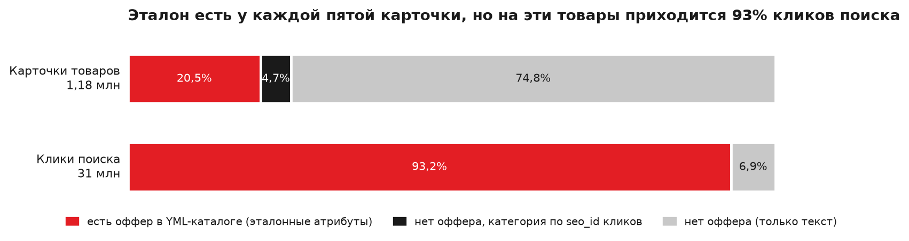
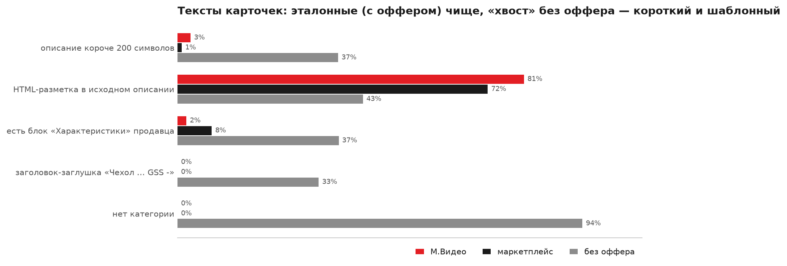
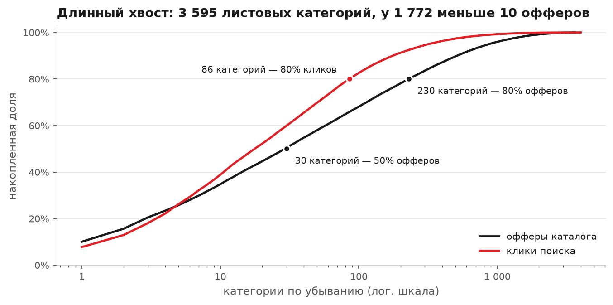
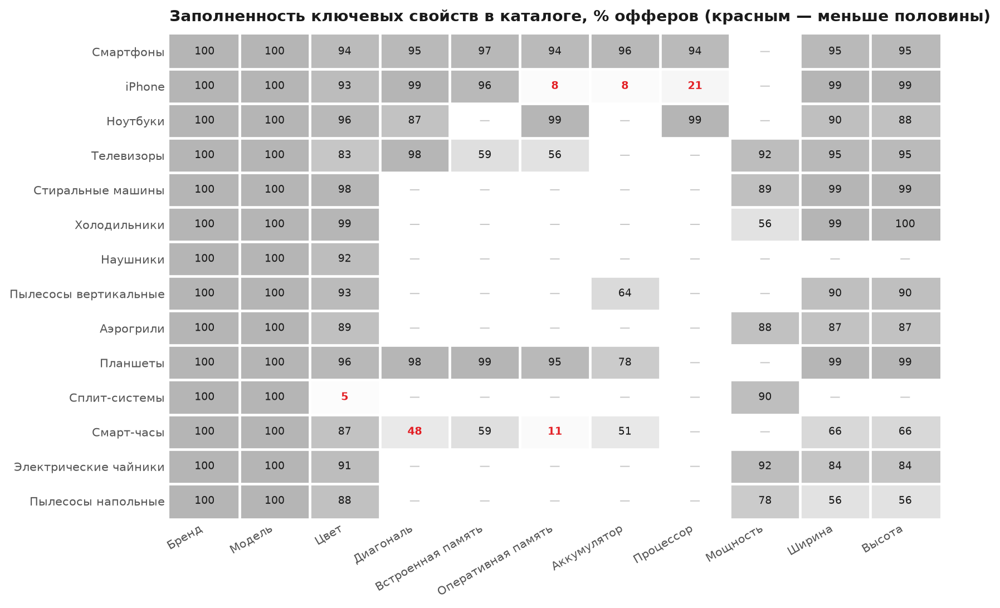
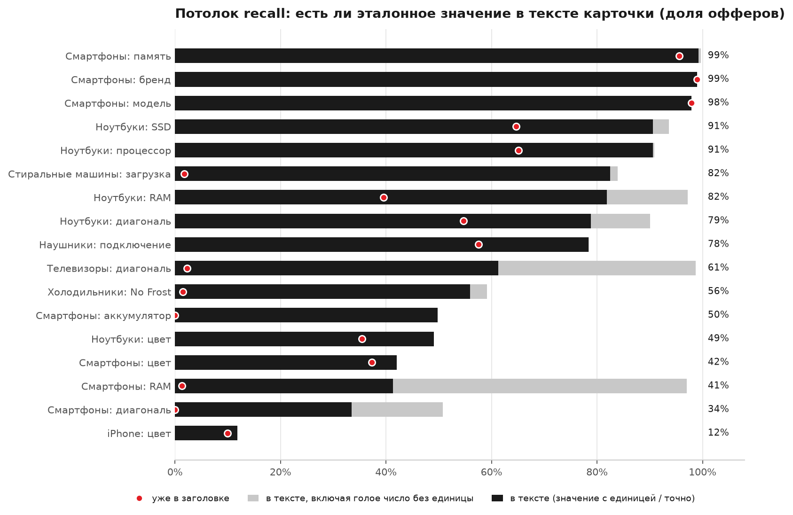
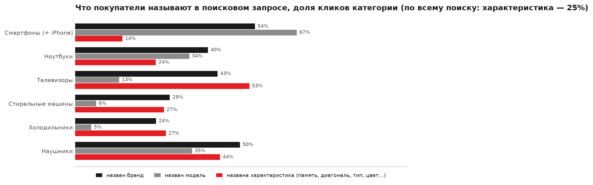
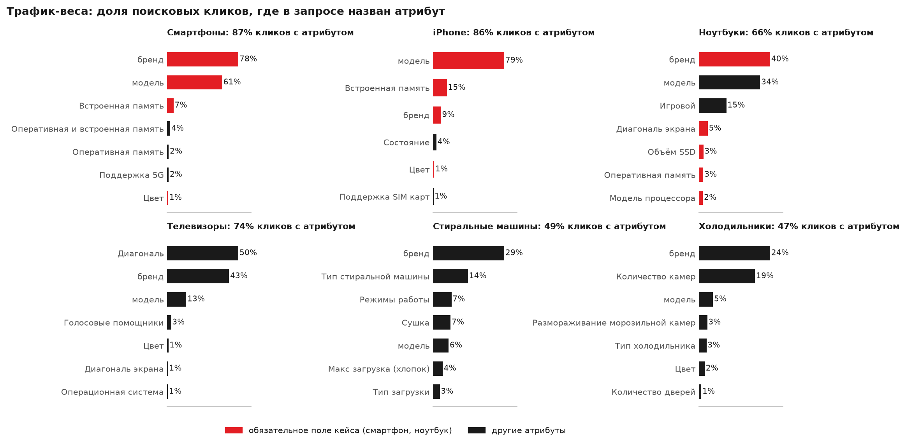
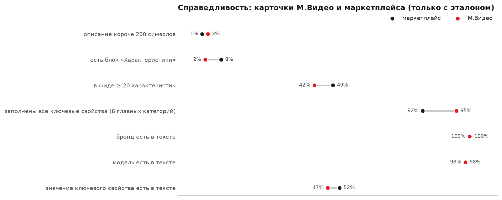

# EDA: данные кейса М.Видео — поля, пропуски, распределения, поисковый спрос

Артефакт №3 комплекта сдачи. Анализ сделан на **полной выгрузке организаторов**, а не на сэмпле:
1 177 200 карточек (`sku_desc.parquet`), YML-каталог М.Видео (`skus.pkl`: 546 069 офферов, 20 975 731 строка
характеристик, 6 963 категории) и 30 991 350 поисковых кликов (`query_clicks.parquet`).

- Полный разбор с таблицами, кодом и выводами после каждого раздела — **[notebooks/01_eda.ipynb](../notebooks/01_eda.ipynb)**
  (выполнен, результаты сохранены в ноутбуке).
- Расчёты — `src/attrx/data/eda.py` (агрегаты DuckDB поверх `data/processed/*.parquet`), трафик-веса —
  `src/attrx/data/traffic.py`. Цифры — `data/processed/eda_stats.json`, `data/processed/business_stats.json`;
  веса — `config/traffic_weights.yaml`, сводка по категориям — `submission/traffic.json`.

```bash
uv pip install -p .venv/bin/python -e ".[dev,eda]"          # + matplotlib и Jupyter для графиков и ноутбука
bash scripts/download_data.sh && .venv/bin/attrx prepare   # data/raw -> data/processed (≈ 8 мин, один раз)
.venv/bin/attrx traffic     # трафик-веса из 31 млн поисковых кликов (≈ 5 мин, ≤ 4 ГБ RAM)
.venv/bin/attrx eda-real    # графики docs/img/eda_*.png + eda_stats.json + business_stats.json (≈ 1 мин)
.venv/bin/jupyter nbconvert --to notebook --execute --inplace notebooks/01_eda.ipynb   # ноутбук (≈ 1,5 мин)
# то же через make: make traffic eda-real eda-nb
```

## Ключевые цифры

| Что | Значение |
|---|---|
| Карточек с эталоном (оффер YML с атрибутами) | **241 355 — 20,5%**; на эти SKU приходится **93,2%** кликов поиска |
| Карточек только с текстом (нет ни оффера, ни категории) | **880 632 — 74,8%** |
| Описаний короче 200 символов | 30% (без оффера — 37%, у карточек с эталоном — 1–3%) |
| HTML-разметка в исходных описаниях | 72–81% у карточек с эталоном, 43% у остальных |
| Карточки-заглушки «Чехол … GSS -» / «UNIMALL -» | 306 988 — 33% карточек без оффера |
| Листовых категорий с офферами / из них с < 10 офферов | 3 595 / 1 772 (медиана — 10 офферов) |
| Разных характеристик в каталоге / медиана на оффер | 10 696 / 19 |
| Написаний единицы памяти в заголовках | 12 (`GB`, `G`, `Gb`, `TB`, `ГБ`, `Гб`, `ТБ`, `Tb`, `Г`, `Тб`, `gb`, `гб`) |
| Эталонное значение есть в тексте карточки | бренд 99%, память смартфона 99%, … диагональ смартфона 34%, цвет iPhone 12% |
| Клики, где запрос называет атрибут | **56,5%**; характеристику кроме бренда и модели — **24,9%** |
| Офферы, где заполнены все ключевые свойства | М.Видео 95% vs партнёры маркетплейса 82% |

## 1. Источники и связки

Три файла связываются по `sku_id`. Оффер YML — это и есть размеченная часть: `vendor`, `model` и `param[]` заводит
контент-команда М.Видео, поэтому они служат эталоном (gold), а на вход модели подаётся только текст карточки.



| Связка по `sku_id` | SKU | Доля |
|---|---:|---|
| карточки ∩ офферы (= есть эталон) | 241 355 | 20,5% карточек, 44,2% офферов |
| карточки без оффера, категория по `seo_id` кликов | 55 213 | 4,7% карточек |
| карточки без оффера и без кликов (только текст) | 880 632 | 74,8% карточек |
| кликнутые SKU ∩ офферы | 241 661 | **93,2% кликов** |
| кликнутые SKU ∩ карточки | 158 158 | 63,8% кликов |

**Вывод.** Эталон покрывает «голову» спроса: качество меряем на 241 тыс. карточек с эталоном (holdout — 24 143),
а на 0,9 млн карточек без оффера — покрытие. У трёх четвертей карточек нет категории, поэтому пайплайну нужен
классификатор категории по тексту и извлечение без опоры на каталог (cold start). `seo_id` кликов совпадает с
категорией каталога у 97,7% SKU — это бесплатная категория ещё для 55 тыс. карточек.

## 2. Поля и пропуски

Формальных NULL почти нет: заголовок и описание есть у всех карточек (пустых описаний 0,01%), `vendor` пуст у 11
офферов из 546 069. Пропуски — содержательные, и они сосредоточены в карточках без оффера:



| Признак | М.Видео | Маркетплейс | Без оффера |
|---|---:|---:|---:|
| описание короче 200 символов | 3,0% | 1,0% | 37,3% |
| описание короче 50 символов | 0,7% | 0,1% | 9,1% |
| HTML-разметка в исходном описании | 80,5% | 72,1% | 43,1% |
| блок «Характеристики» продавца | 2,1% | 8,0% | 37,4% |
| заголовок-заглушка «… GSS -» / «… UNIMALL -» | 0% | 0% | 32,8% |
| нет категории | 0% | 0% | 94,1% |
| медиана длины заголовка / описания, символов | 49 / 868 | 58 / 1 057 | 39 / 440 |

**Вывод.** Без очистки не обойтись: HTML (в т.ч. двойное экранирование `&lt;br&gt;`) → текст, блок
«Характеристики» → пары `seller_attrs` (`src/attrx/data/text.py`). Блок продавца есть у 31% всех карточек, но почти
только вне каталога: для «хвоста» это самый дешёвый источник атрибутов, а на эталонных карточках главный источник —
свободный текст. Тексты длинные (p90 ≈ 1,6–1,8 тыс. символов), поэтому LLM на каждую карточку дорог → гибрид.
Распределения длин — [img/eda_lengths.png](img/eda_lengths.png).

## 3. Категории: длинный хвост

Дерево — 3 уровня (96 → 1 088 → 5 779), все офферы лежат в листьях; офферы есть у 3 595 листьев.



| Полоса (по накопленной доле офферов) | Категорий | Медиана офферов | Доля офферов | Доля кликов | Доля карточек с эталоном |
|---|---:|---:|---:|---:|---:|
| head (первые 50% офферов) | 29 | 5 338 | 49,9% | 25,0% | 45,5% |
| torso (до 80%) | 200 | 631 | 30,1% | 51,8% | 31,2% |
| tail (остальные) | 3 366 | 8 | 20,0% | 23,2% | 23,3% |

**Вывод.** У половины категорий меньше 10 офферов, но хвост — это четверть кликов поиска и эталона. Ручные правила
на каждую категорию не масштабируются: таксономия и справочники строятся из данных (`param_stats.parquet` —
заполненность всех 10 696 параметров во всех категориях; `taxonomy_candidates.json` — кандидаты для топ-25 категорий,
56% кликов), для хвоста — универсальные атрибуты + LLM, метрики отчитываются по полосам head/torso/tail.

## 4. Атрибуты каталога: заполненность, значения, нормализация

Медиана — 19 характеристик на оффер (М.Видео — 17), у 15–21% офферов их меньше пяти; 15% строк `param` — служебные
(продавец, подборки, бонусы, гарантия). У 23% пар «SKU × свойство» есть и **бакет фильтра**, и **точное значение**
`_search`: «1 ТБ» ↔ «1024 ГБ», «6.6" и более» ↔ 6.7", «Диагональ» 50 ↔ «Диагональ экрана» 127 см, «56 - 60 см» ↔
598 мм, «8 - 8.9 кг» ↔ 8 кг. Эталоном берём точное значение.



Бренд и модель заполнены у 100% офферов, цвет — у 83–99%; системные дыры: у iPhone RAM и ёмкость аккумулятора — 8%
(Apple их не публикует), у смарт-часов диагональ — 48%, у сплит-систем цвет — 5%. Значения сконцентрированы:
256/512/128 ГБ — 86% смартфонов, 16 ГБ — 61% ноутбуков, пять диагоналей — 70% телевизоров
([img/eda_values.png](img/eda_values.png)) → справочники допустимых значений компактны.

Почему нужна нормализация (реальные примеры из заголовков и каталога; график — [img/eda_units.png](img/eda_units.png)):
- **единицы:** 12 написаний ГБ/ТБ — `GB` 42 401, `G` 11 974, `Gb` 9 060, `TB` 5 726, `ГБ` 2 789, `Гб` 1 322 …;
- **пары RAM/ROM:** «8/256GB» в 52% заголовков смартфонов и планшетов, «12+256» — ещё в 4%, «8GB/256GB» и
  «8GB+256GB» — в 1,5%;
- **диагональ:** у телевизоров явно («55"», «55 дюймов», «139 см») — лишь в 2% заголовков, зато в 75% она зашита
  в код модели (`55C6K`, `UE55DU7100`); у ноутбуков — `15.6"` в 45% заголовков;
- **цвета:** в заголовке смартфона цвет по-английски в 51% случаев (`Black`, `Titanium Gray`, `Starlight`),
  в фильтре — по-русски: `Black` → «черный» (661 оффер), `Cosmic Orange` → «оранжевый», `Blue` → то «синий»,
  то «голубой», `Deep Blue` → «синий».

## 5. Извлекаемость: потолок recall

Доля офферов, у которых эталонное значение буквально или в нормализованной форме (`256 ГБ ~ 256GB`,
`1024 ГБ ~ 1 ТБ`) есть в title + описании + `seller_attrs` (до 1 500 офферов на категорию).



**Вывод.** Бренд, модель и память смартфона есть в тексте у 98–99% карточек, процессор и SSD ноутбука — у 91%:
это ядро, которое закрывают правила и словари. Но RAM смартфона — 41% (97%, если засчитать «8» из «8/256»),
аккумулятор — 50%, диагональ смартфона — 34%, цвет iPhone — 12%. Шире ещё жёстче: из 1 575 заметных свойств
топ-25 категорий (заполнены у ≥ 50% офферов) лишь 109 (6,9%) упоминаются в тексте хотя бы у половины карточек,
43% из них — флаги «Да/Нет». Поэтому recall считаем и от всего эталона, и от «извлекаемого», а значение, которого
нет в тексте, автоматически не принимаем — иначе это галлюцинация.

## 6. Поисковый спрос и трафик-веса

Детектор упоминаний (`src/attrx/data/traffic.py`, тесты — `tests/test_traffic.py`) для каждой категории строит
словарь из её каталога — бренды и их кириллические написания (307 написаний 173 брендов найдены в логах: токен
запроса, ≥ 60% кликов которого ведут на один бренд и который транслитерацией похож на него: «самсунг», «хайер»,
«ксиоми»), токены моделей, частые значения параметров с единицами («256 гб», «55"», «9кг»), пары памяти «8/256»,
текстовые значения («узкая», «no frost»), имена свойств-флагов («игровой», «с алисой»), цвета — и размечает
каждый из 1,33 млн пар (категория, запрос). **Вес атрибута = доля кликов категории, в запросах которых он назван.**
Размечено 255 категорий (93,2% кликов): топ-25, все листья `config/taxonomy.yaml` и все категории с ≥ 10 тыс. кликов. Оценка снизу: описательные запросы без значения («маленький холодильник»)
не засчитываются.



Запросы короткие (одно слово — 24% кликов, два — 36%), но в **56,5% кликов** назван атрибут: бренд — 32,0%,
модель — 20,2%, характеристика кроме бренда и модели — **24,9%** (число с единицей или частое значение — 10,0%,
текстовое значение или свойство-флаг — 15,7%, цвет — 1,1%).



| Категория | Кликов | С атрибутом | Самые востребованные атрибуты (доля кликов категории) |
|---|---:|---:|---|
| Смартфоны (761) | 2,40 млн | 87% | бренд 78%, модель 61%, встроенная память 7,2%, RAM+ROM «8/256» 3,5%, RAM 1,8%, 5G 1,7%, цвет 1,3%, состояние 1,0% |
| iPhone (914) | 1,27 млн | 86% | модель 79%, встроенная память 15%, бренд 8,9%, состояние 3,9%, цвет 1,5%, eSIM 0,7% |
| Ноутбуки (987) | 0,94 млн | 66% | бренд 40%, модель 34%, «игровой» 15%, диагональ 5,1%, SSD 2,6%, RAM 2,6%, процессор 2,3%, цвет 2,1% |
| Телевизоры (1682) | 1,25 млн | 74% | **диагональ 50%**, бренд 43%, модель 13%, голосовой помощник «Алиса» 2,8%, цвет 1,0% |
| Стиральные машины (2447) | 1,60 млн | 49% | бренд 29%, тип («узкая», «с вертикальной загрузкой») 14%, сушка 7,1%, модель 6,3%, загрузка «7 кг» 3,9% |
| Холодильники (666) | 1,59 млн | 47% | бренд 24%, **количество камер («двухкамерные») 19%**, модель 4,9%, No Frost 2,9%, тип («с нижней морозильной камерой») 2,6%, цвет 2,0%, двери 0,9% |
| Наушники (31607) | 0,91 млн | 91% | бренд 50%, **тип подключения («беспроводные») 39%**, модель 35%, тип наушников 4,1%, кабель Type-C 1,3%, цвет 1,2% |

**Вывод.** Что ищут, сильно зависит от категории, и обязательные поля кейса совпадают со спросом не полностью:
диагональ и аккумулятор смартфона почти не ищут (0,2% и 0,05% кликов), а «восстановленный» — ищут. Поэтому веса
для traffic-weighted метрик и приоритета очереди модерации берутся из данных: `config/traffic_weights.yaml`
(`{category_id: {vendor | model | имя параметра YML: вес}}`) уже читают `src/attrx/taxonomy.py` и
`src/attrx/eval/metrics.py`. Бакет и точное значение одного свойства получают одинаковый вес. В
`submission/traffic.json` для каждой категории таксономии (smartphone, laptop, tv, …) есть `by_attribute` — вес её
атрибутов: смартфон — модель 0,67, бренд 0,54, память 0,10, цвет 0,014, диагональ 0,0015, аккумулятор 0,0003.

## 7. Справедливость: М.Видео и партнёры маркетплейса

Только карточки с эталоном; «есть в тексте» — проверка на детерминированной выборке до 300 карточек на категорию
и сегмент в 7 главных категориях (24 847 проверок).



| | М.Видео | Маркетплейс |
|---|---:|---:|
| описание короче 200 символов | 3,0% | 1,0% |
| бренд / модель есть в тексте | 99,6% / 98,1% | 99,9% / 98,1% |
| значение ключевого свойства есть в тексте | 47,3% | 51,7% |
| в фиде заполнены все ключевые свойства (6 главных категорий) | **94,8%** | **82,3%** |
| … телевизоры / ноутбуки / наушники | 96% / 88% / 93% | 74% / 69% / 81% |

**Вывод.** Тексты партнёров не беднее, а вот в каталоге их офферы описаны хуже — извлечение из текста в первую
очередь выравнивает карточки маркетплейса. Метрики и покрытие отчитываем по сегментам продавца, порог
автопринятия одинаковый для всех.

## Что это значит для бизнеса

Формулировки — ровно то, что показывают данные (`data/processed/business_stats.json`).

- **935 845 карточек выгрузки (79,5%) не имеют структурированных атрибутов в данных кейса**: их SKU нет в
  выданном YML-снимке каталога. Это не значит, что у товара нет атрибутов в системах М.Видео, — но в данных
  кейса характеристики для них можно получить только из текста; у 880 632 нет даже категории.
- **56,5% поисковых кликов** — по запросам, где покупатель назвал атрибут, **24,9%** — характеристику кроме бренда
  и модели. Телевизор ищут по диагонали в половине кликов, наушники по типу подключения — в 39%: незаполненное
  свойство — это карточка, которая не попадает в фильтр и выдачу по такому запросу.
- Даже в курируемом каталоге у **4–26%** офферов главных категорий не заполнено хотя бы одно ключевое свойство
  (ноутбуки — 26%, телевизоры — 20%, наушники — 15%, смартфоны — 9%, холодильники — 8%, стиральные машины — 4%);
  на эти офферы приходится **4–10% поисковых кликов** категории. У iPhone — 93% (нет ёмкости аккумулятора).
- Полностью описано 95% офферов М.Видео и 82% офферов партнёров — автозаполнение из текста прежде всего помогает
  маркетплейсу (2 047 продавцов, 84% офферов).
- Ядро атрибутов (бренд, модель, память, процессор, SSD) есть в тексте у 91–99% карточек — его можно заполнять
  дёшево правилами; то, чего в тексте нет (диагональ смартфона в 66% случаев), честнее отдать в очередь модерации,
  чем «угадать».

## Как EDA определила решение

| Находка | Решение | Где в коде |
|---|---|---|
| HTML в 43–81% описаний, блок «Характеристики» у 31% карточек | очистка HTML и разбор блока в `seller_attrs` до извлечения; seller_attrs — первый источник | `src/attrx/data/text.py`, `src/attrx/extractors/seller.py` |
| У 74,8% карточек нет категории, `seo_id` = категория у 97,7% | категория до извлечения: `category_id` → название → классификатор → ключевые слова; seo_id кликов даёт категорию ещё 55 тыс. карточек | `Taxonomy.detect_category` в `src/attrx/taxonomy.py`, `src/attrx/data/prepare.py` |
| Эталон — 20,5% карточек, но 93% кликов | честная оценка на реальном эталоне: dev / holdout по `md5(sku_id)` | `src/attrx/eval/gold.py`, `docs/EVALUATION.md` |
| Бакет и точное значение одного свойства | эталон = точное `_search`-значение; бакет выводится из него | `src/attrx/eval/gold.py`, `config/taxonomy.yaml` |
| 3 595 категорий, у половины < 10 офферов | таксономия и словари из данных, generic-схема и LLM для хвоста, разрез head/torso/tail | `config/taxonomy.yaml`, `data/processed/param_stats.parquet` |
| 12 написаний ГБ, «8/256», «12+256», дюймы/см/мм, английские цвета | нормализация к канону и справочники допустимых значений | `src/attrx/normalize.py`, `config/dictionaries/` |
| Значение есть в тексте у 12–99% (медиана по всем свойствам — 1%) | recall от всего и от «извлекаемого» эталона; заземление цитатой, иначе «на проверку» | `src/attrx/verify.py`, `src/attrx/eval/metrics.py` |
| Спрос на атрибуты зависит от категории (ТВ — диагональ 50%) | traffic-weighted F1 и приоритет очереди модерации по весам из кликов | `config/traffic_weights.yaml`, `src/attrx/eval/metrics.py` |
| Партнёры маркетплейса описаны в каталоге хуже (82% vs 95%) | метрики и покрытие по сегментам продавца, единый порог | `submission/segments.json` |

## Ограничения

- Эталон — это то, что заполнено в каталоге: незаполненное свойство — не «ошибка модели», а пропуск эталона
  (учитывается в протоколе оценки, `docs/EVALUATION.md`).
- Трафик-веса — нижняя оценка: детектор находит названные значения и свойства, но не описательные запросы
  («маленький холодильник», «для дачи») и сильные опечатки. Клики привязаны к категории кликнутого SKU.
- Извлекаемость считается строковым совпадением с нормализацией единиц; синонимы («Cosmic Orange» ↔ «оранжевый»)
  не засчитываются, поэтому для цвета это тоже оценка снизу.
