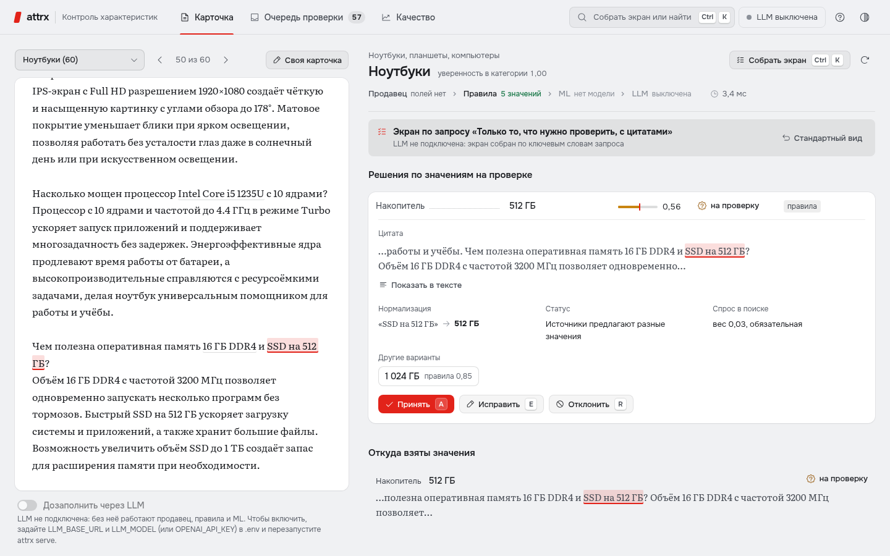

# Generative UI

Идея как в Agentic OS: экран модератора не свёрстан заранее под один сценарий, а собирается под задачу.
В проде М.Видео нельзя выполнять произвольный HTML/JS от модели, поэтому сделано так:

1. Бэкенд извлекает характеристики (`ExtractionResult`).
2. Модератор формулирует задачу в палитре команд (Ctrl/⌘ K в веб-интерфейсе), например
   «только то, что нужно проверить, с цитатами». Запрос уходит в `POST /api/ui` вместе с результатом.
3. LLM получает только метаданные (ключи атрибутов, статусы, уверенность, число альтернатив, предупреждения) и запрос,
   а возвращает **UISpec**: заголовок, раскладку и список компонентов из фиксированного словаря (таблица ниже).
4. UISpec валидируется pydantic-схемой (`src/attrx/genui/schema.py`, strict JSON Schema для `response_format`):
   неизвестный компонент или лишнее поле → откат; ключи атрибутов фильтруются по результату, разметка в тексте экранируется.
5. Фронтенд (`web/components.js`) рендерит компоненты, а **значения берёт из result, не из ответа LLM**:
   модель не может показать характеристику, которой нет. Весь текст выводится через textContent.
6. Без LLM запрос всё равно учитывается: `compose_intent` подбирает компоненты по ключевым словам
   («провер…» → решения + цитаты, «уверен…» → график уверенности, «спорн…» → конфликты, «метрик…» → качество).
   В интерфейсе честно написано, кто собрал экран: LLM или подбор по словам.
7. Стандартный экран карточки — тоже UISpec (`compose_default`): сводка, таблица характеристик, спорные значения.

## Словарь компонентов

| Компонент | Что показывает | Параметры |
|---|---|---|
| `summary` | полоса «часть целого» и счётчики: принято / на проверку / нет в тексте; счётчики работают как фильтр | `text` |
| `alert` | короткое сообщение | `level`: info, success, warning, danger; `text` |
| `attribute_table` | характеристики: значение, уверенность со шкалой и засечкой порога, статус, источники; строка раскрывается в цитату в контексте, нормализацию, альтернативы и решение | `filter`, `attributes`, `title` |
| `confidence_chart` | уверенность каждого значения относительно порога автопринятия | `filter`, `attributes` |
| `evidence` | цитаты из текста карточки, на которых основано каждое значение | `attributes` |
| `review_queue` | значения на проверке с кнопками «Принять / Исправить / Отклонить» (решение пишется в feedback) | `filter` |
| `conflicts` | спорные значения (что предложил каждый источник) и отброшенные проверкой цитаты значения LLM | `attributes` |
| `metrics` | качество на эталоне: точность, полнота, F1, F1 с учётом спроса, покрытие | — |

## Как добавить компонент

1. Тип в `ComponentType` и описание в `COMPONENTS` (`src/attrx/genui/schema.py`) — описание само попадёт в системный промпт.
2. Ключевые слова в `_INTENTS` (`src/attrx/genui/composer.py`), если компонент нужен и без LLM.
3. Функция в `registry` (`web/components.js`): данные только из result, вывод через `h()`.
4. Тест (`tests/test_api_ui.py`, `tests/test_llm.py`) и строка в таблице выше.

Подробнее про устройство интерфейса и дизайн-токены: [web/README.md](../web/README.md).
